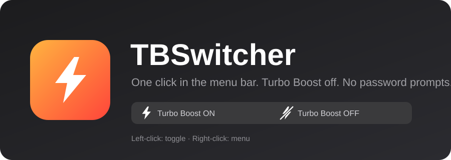

<p align="center">
  
</p>

# ⚡ TBSwitcher

A tiny menu bar switch for Intel Turbo Boost.
Click the bolt → Turbo Boost goes off (cooler, quieter, longer battery). Click again → it's back.
**No admin password on every click.**

🇷🇺 [Читать по-русски](README.ru.md)

> **Status:** early release. Verified on one Mac: MacBook Pro 16" (Intel), macOS Tahoe 26, SIP enabled — Turbo Boost really switches off and on (checked with `powermetrics`, see below). Reports from other setups are very welcome.
> **Intel Macs only** — Apple Silicon has no Turbo Boost to control.

## Install

You need an Intel Mac, macOS 13 or newer, and the Command Line Tools (`xcode-select --install`).

**One line:**

```bash
curl -fsSL https://raw.githubusercontent.com/Mabykar/TBSwitcher/main/get.sh | bash
```

It downloads the source to a temporary folder, tells you exactly what it is about to install, asks you to confirm,
builds, and runs `install.sh` (admin password asked **once**). Pin a version with `... | TBSWITCHER_REF=v1.2.0 bash`.
Uninstall the same way: `curl -fsSL https://raw.githubusercontent.com/Mabykar/TBSwitcher/main/get.sh | bash -s -- --uninstall`.

> Piping a script into your shell means trusting it, and this one installs a root helper and a kernel extension.
> [Read `get.sh`](get.sh) first, or use the manual way below.

**Manual:**

```bash
git clone https://github.com/Mabykar/TBSwitcher.git
cd TBSwitcher
bash install.sh
```

macOS may ask you to allow the kernel extension the first time:
**System Settings → Privacy & Security → Allow**, then restart and click ⚡ again.

## Use

| Action | What happens |
|---|---|
| **Left-click** ⚡ | Toggle Turbo Boost (the bolt dims for a moment while it switches) |
| **Right-click** ⚡ | Menu: status, restore choice after sleep/reboot, launch at login, credits, quit |
| ⚡ filled | Turbo Boost **ON** (normal) |
| ⚡ struck through | Turbo Boost **OFF** |

Remove everything: `bash uninstall.sh`. Something odd: `bash doctor.sh` prints a report you can paste into an issue.

## Check that it really works

```bash
sudo powermetrics --samplers cpu_power -i 2000 -n 2 | grep "CPU Average frequency"
```

Run it with Turbo Boost off, then on, under some load. On the author's Mac: **off** → never above ~97 % of nominal frequency;
**on** → peaks of ~176 % (about 4.2 GHz).

## About the kext and signing

Apple normally expects kernel extensions to be code-signed. The kext in [`Vendor/`](Vendor/) has no `_CodeSignature` folder,
i.e. it is **not signed** — and still, on the author's Mac (SIP **enabled**, no custom boot-args) it loads after the usual approval and works.
We don't know why, nor whether every Mac and macOS version behaves the same.

If macOS refuses to load it on yours:

1. Run `bash doctor.sh` and open an issue with the output.
2. Try another build of the kext (a signed one, if you have it): `bash install.sh --kext /path/to/DisableTurboBoost.64bits.kext`.
   The installer prefers a code-signed kext when it finds one and tells you when it uses an unsigned one.

We deliberately don't support relaxing SIP to make it work.

## How it works

```
⚡ menu bar app (you)  ──XPC──▶  tiny helper (root, LaunchDaemon)  ──▶  kextutil / kextunload
                                  accepts only "on" / "off"            DisableTurboBoost.kext
```

The kext flips the Turbo Boost bit in the CPU's MSR register while it is loaded: **kext loaded = Turbo Boost off**.
Loading a kext needs root, so a small helper is installed once (that is the one password prompt) and does it on request.
It accepts exactly one thing — a boolean. See [SECURITY.md](SECURITY.md).

## FAQ

**Will Turbo Boost stay off after sleep or reboot?**
Other tools built on the same kext report that it can be unloaded on wake. TBSwitcher remembers your last choice and
re-applies it after wake and at launch (menu: *Restore my choice after sleep / reboot*, on by default).

**Why does macOS ask me to allow an extension?** It does that for third-party kernel extensions.

**Why isn't the app notarized?** That needs a paid Apple Developer ID. For now you build it yourself from source — which is also why you can read every line.

## Credits ❤️

This project exists only because of two people. **Huge thanks to:**

- **Rubén García Pérez ([rugarciap](https://github.com/rugarciap))** — author of [Turbo Boost Switcher](https://github.com/rugarciap/Turbo-Boost-Switcher), whose app and kernel extension make all of this possible.
  If you want sensors, charts, auto modes and a polished, signed app, please buy his [PRO version](https://www.rugarciap.com/turbo-boost-switcher-for-os-x/) — that is what keeps the whole thing alive.
- **Adam Strzelecki ([nanoant](https://github.com/nanoant))** — author of the original [DisableTurboBoost.kext](https://github.com/nanoant/DisableTurboBoost.kext).

TBSwitcher is an independent, minimal project and is not affiliated with either of them. Details: [NOTICE.md](NOTICE.md).

## License

TBSwitcher's own code is [MIT](LICENSE). Third-party files in `Vendor/` keep their original licenses — see [NOTICE.md](NOTICE.md).
